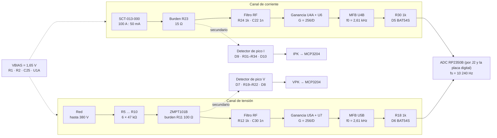

# Front end analógico: cálculo y justificación de componentes

Este documento reúne los cálculos de todos los componentes del front end analógico de una línea: el canal de corriente, el canal de tensión, la referencia VBIAS y los detectores de pico. El analizador lleva cuatro placas iguales (L1, L2, L3 y N), conectadas a la [placa digital](../digital/README.md), que tiene los ADC de los detectores (MCP3204) y el expansor de E/S (MCP23017). Todos los valores están normalizados a series comerciales: **resistencias E24 al 1 %** y **capacitores E12**.

- Esquemático: [analog.kicad_sch](analog.kicad_sch), con las hojas [current_channel.kicad_sch](current_channel.kicad_sch) y [voltage_channel.kicad_sch](voltage_channel.kicad_sch).
- Simulaciones: [simulations/README.md](../../simulations/README.md).
- Detalle del sensor de corriente y de la etapa de ganancia: [canal_corriente.md](canal_corriente.md).
- Placa digital (ADC de picos, expansor, conector al RP2350B): [hardware/digital](../digital/README.md).

## 1. Datos de partida

| Dato | Valor | Origen |
|---|---|---|
| ADC de las señales | Interno del RP2350B, 12 bits, 0 a 3,3 V, entrada simple (8 canales: 4 V + 4 I) | [docs/architecture.md](../../docs/architecture.md) |
| ADC de los detectores de pico | MCP3204 (12 bits, SPI) en la placa digital, referencia 3,3 V | [hardware/digital](../digital/README.md) |
| Frecuencia de muestreo por canal | **fs = 10 240 Hz** (Nyquist 5120 Hz) | Firmware: `CONFIG_ADC_STREAM_PER_CHANNEL_SAMPLE_RATE_HZ` |
| Banda de interés | Fundamental de 50 Hz hasta la **armónica 31 (1550 Hz)** | Requisito |
| Criterio de planitud | Caída ≤ 0,5 dB en 1550 Hz, en el **peor caso** de tolerancias | Requisito |
| Alimentaciones | 5 V (LM358) y 3,3 V (MCP41010, VBIAS), desde la placa digital por J2 | Placa digital |
| Excursión útil a la salida | VBIAS ± 1,4 V (0,25 V a 3,05 V) | Límite de salida del LM358 a 5 V |
| Series comerciales | Resistencias E24 1 %, capacitores E12 | Disponibilidad en Argentina |

## 2. Diagrama de bloques



Todo el canal trabaja alrededor de VBIAS = 1,65 V, la mitad del rango del ADC. Cada nodo es VBIAS más una componente de señal, y el firmware resta el valor medio.

## 3. Referencia VBIAS

### R1, R2 = 10 kΩ: divisor

```
VBIAS = 3,3 V · R2 / (R1 + R2) = 3,3 V · 10k / 20k = 1,65 V
```

- Con resistencias de 1 %, el error es como mucho ±16 mV. No importa, porque el firmware resta la media de cada canal.
- Consumo: 3,3 V / 20 kΩ = 165 µA.
- 10 kΩ es un compromiso: un valor más bajo consume más, y uno más alto pide un capacitor de filtro más grande para el mismo corte.

### C25 = 10 µF: filtro del divisor

```
fc = 1 / (2π · (R1 ∥ R2) · C25) = 1 / (2π · 5 kΩ · 10 µF) = 3,2 Hz
```

- El ruido de VBIAS llega al ADC con ganancia 1, así que conviene filtrar bien el ruido de los 3,3 V. A 50 Hz atenúa 24 dB.
- Arranque: 5τ = 5 · 5 kΩ · 10 µF = 250 ms hasta que VBIAS se estabiliza.
- Puede ser X7R: la deriva de capacidad solo mueve el corte, y la tensión aplicada es baja (1,65 V).

### U1A: seguidor

VBIAS recibe la corriente alterna de las redes de realimentación: los potenciómetros de 10 kΩ de los dos canales. Sin buffer, esa corriente sobre los 5 kΩ del divisor movería VBIAS al ritmo de la señal (hasta ±0,7 V), y como VBIAS es la referencia, la medición quedaría arruinada.

### R4 = 0 Ω, C26 sin colocar

- El seguidor maneja VBIAS directo. En la simulación, la diafonía V→I baja de 3,6 mV (con 47 Ω + 1 µF y los dos potenciómetros de 10 kΩ) a menos de 0,05 mV ([simulations/README.md](../../simulations/README.md), sección 3).
- Si el seguidor oscila en banco: R4 = 47 Ω y C26 = 1 µF.

### R3 = 1 kΩ: pull-down de U1A

Mantiene la salida del LM358 siempre entregando corriente (1,65 V / 1 kΩ = 1,65 mA), así nunca cruza la zona muerta de su etapa de salida clase B.

## 4. Canal de corriente

### R23 = 15 Ω, 0,1 %: burden del TC

El SCT-013-000 es 100 A : 50 mA (N = 2000).

```
Sensibilidad:      k = R23 / N = 15 Ω / 2000 = 7,5 mV/A (rms)
Fondo de escala:   I_max = 1,4 V / (√2 · 7,5 mV/A) = 132 A rms con G = 1
Disipación:        P = (50 mA)² · 15 Ω = 37,5 mW a 100 A; 73,5 mW a 140 A (saturación)
Fase del TC:       tan φ = (R23 + Rw) / (ω · Lm) → φ = 3,8° con Rw ≈ 100 Ω, Lm ≈ 5,5 H
```

- 15 Ω es el valor más bajo que todavía cubre 100 A con G = 1 dentro de ±1,4 V. Un burden más bajo reduce el error de fase del TC (3,8° contra 7,3° con 120 Ω).
- **0,1 % y ≤ 25 ppm/°C**, porque su tolerancia entra directo en la ganancia. 1206 de 0,25 W: disipa como mucho 74 mW.

### R24 = 1 kΩ, C22 = 1 nF C0G: filtro de RF

```
fc = 1 / (2π · 1 kΩ · 1 nF) = 159 kHz
Fase a 1550 Hz = −atan(1550 / 159 k) = −0,56°
```

- Saca el ruido de RF que entra por el cable del TC. No es el filtro antialiasing.
- R24 limita la corriente hacia los diodos de entrada del LM358 ante transitorios.
- C22 va a VBIAS: el filtro actúa sobre la señal diferencial, y el ruido de VBIAS no se convierte en señal.
- Error por corriente de polarización: 45 nA · (1 kΩ + 15 Ω) = 46 µV, despreciable.
- C0G porque no cambia con la temperatura ni con la tensión. El mismo valor está en el canal V (R12, C30), así que los desfasajes se cancelan.

### U4A + U6 (MCP41010): ganancia variable

U4A es no inversor y el MCP41010 funciona como divisor en la realimentación (A = salida, W = entrada −, B = VBIAS):

```
G = 256 / D
```

| D | G | I máx. (rms) | Polo de U4A (GBW 0,7 MHz / G) | Fase de U4A a 1550 Hz |
|---|---|---|---|---|
| 255 | 1,0 | 132 A | 700 kHz | −0,1° |
| 64 | 4 | 33 A | 175 kHz | −0,5° |
| 16 | 16 | 8,2 A | 43,8 kHz | −2,0° |
| 8 | 32 | 4,1 A | 21,9 kHz | −4,0° |

- La ganancia depende solo de la relación D/256: la tolerancia de ±20 % del potenciómetro se cancela.
- G máxima = 32 (D ≥ 8): el offset del LM358 (7 mV máx.) multiplicado por 32 da 224 mV, que todavía entra en la excursión.
- La fase en 1550 Hz varía 4° entre G = 1 y G = 32: se calibra por código de ganancia (sección 9).

### R25 = 1 kΩ: pull-down de U4A

La carga de U4A hacia VBIAS es el potenciómetro (10 kΩ) en paralelo con la entrada del MFB (R26 = 10 kΩ), o sea 5 kΩ. Con la fuente interna de 50 µA del LM358, la salida no cruza la zona muerta mientras:

```
V / 1 kΩ + 50 µA ≥ (1,65 V − V) / 5 kΩ   →   V ≥ 0,23 V
```

Queda por debajo del mínimo de 0,25 V de la excursión útil. Simulado con G = 32: THD de 0,08 % con el pull-down y 0,43 % sin él.

## 5. Canal de tensión

### R5, R6, R7, R8, R9, R10 = 6 × 47 kΩ (1206)

```
R_total = 6 · 47 kΩ = 282 kΩ
I_prim  = 380 V / 282 kΩ = 1,35 mA         (ZMPT101B: 2 mA nominal, lineal hasta 10 mA)
P_total = 380² / 282 kΩ = 0,51 W  →  85 mW por resistencia (1206: 0,25 W)
V por resistencia = 380 V / 6 = 63 V       (1206: 200 V de trabajo)
```

| Red | I primaria | P por resistencia | V por resistencia |
|---|---|---|---|
| 220 V | 0,78 mA | 29 mW | 37 V |
| 380 V | 1,35 mA | 85 mW | 63 V |
| 607 V (fondo de escala) | 2,15 mA | 218 mW | 101 V |

- Seis en serie reparten la tensión y la potencia, y si una falla en cortocircuito las demás siguen limitando la corriente.
- 47 kΩ es un valor E24 de fácil acceso. Con 282 kΩ el ZMPT101B trabaja a 1,35 mA en 380 V, dentro de su zona lineal y por debajo de los 2 mA nominales. El rango se elige con el código del MCP41010.
- Hasta el fondo de escala cada resistencia disipa menos de 0,25 W. Una sobretensión sostenida por encima de ~650 V supera ese valor.

### R11 = 100 Ω, 0,1 %: burden del ZMPT101B

```
V_sec = I_prim · 100 Ω  →  sensibilidad = 100 Ω / 282 kΩ = 0,355 mV por volt de red
```

Con 100 Ω el ZMPT101B desfasa menos de 20 minutos de arco (0,3°). Es 0,1 % por la misma razón que R23.

### R12 = 1 kΩ, C30 = 1 nF C0G: filtro de RF

Idénticos a R24 y C22, para que los dos canales tengan el mismo desfasaje.

### U5A + U7 (MCP41010): ganancia variable

La etapa es la misma del canal de corriente: U5A no inversor y el MCP41010 como divisor en la realimentación (A = salida, W = entrada −, B = VBIAS).

```
G = 256 / D
Sensibilidad = 0,355 mV/V · G
Fondo de escala = 1,4 V / (√2 · 0,355 mV/V · G) = 2790 V rms / G
```

| D | G | Fondo de escala (rms) | Uso típico |
|---|---|---|---|
| 255 | 1,0 | 2790 V | — (las 6 × 47 kΩ limitan antes: ~650 V sostenidos) |
| 128 | 2 | 1395 V | Sobretensiones |
| 64 | 4 | 698 V | 380 V entre fases (54 % de la excursión) |
| 32 | 8 | 349 V | 220 V fase–neutro (63 %) |
| 16 | 16 | 174 V | 110 V |
| 8 | 32 | 87 V | Tensiones chicas (por ejemplo, el canal de neutro) |

- **Los dos canales quedan idénticos.** Con el mismo código, el desfasaje de la etapa de ganancia es el mismo en V e I y se cancela en el cálculo de potencia (sección 9). Con códigos distintos, la diferencia es la del término del LM358.
- La ganancia depende solo de D/256: la tolerancia del ±20 % del potenciómetro se cancela, igual que en el canal I.
- El MCP41010 tiene su propio CS (CS_V), que maneja el MCP23017 de la placa digital.
- Con G = 1 el fondo de escala supera lo que aguantan las resistencias del primario; el código útil más bajo es D = 128.

### R13 = 1 kΩ: pull-down de U5A

Carga de U5A: el potenciómetro (10 kΩ) en paralelo con la entrada del MFB (R14 = 10 kΩ), o sea 5 kΩ, igual que en el canal I.

```
V / 1 kΩ + 50 µA ≥ (1,65 V − V) / 5 kΩ   →   V ≥ 0,23 V
```

## 6. Filtro antialiasing: pasabajos MFB de 2do orden (U4B y U5B)

### 6.1 Qué tiene que cumplir

1. **Plano hasta la armónica 31:** caída ≤ 0,5 dB en 1550 Hz, incluso en el peor caso de tolerancias.
2. **Atenuar lo que se pliega sobre la banda**, que empieza en 8690 Hz (ver 6.2).
3. **Ganancia −1** (solo filtra) y valores fijos, **iguales en los dos canales**, para que el desfasaje del filtro se cancele en el cálculo de potencia.
4. Valores E24 / E12.

### 6.2 Por qué el pliegue empieza en 8690 Hz

Al muestrear a fs, una componente de frecuencia f aparece en la frecuencia

```
f_alias = | f − k · fs |      (con el k entero que la deja entre 0 y fs/2)
```

Para que una componente caiga dentro de la banda analizada (0 a 1550 Hz), tiene que estar a menos de 1550 Hz de algún múltiplo de fs:

```
k · fs − 1550 Hz  ≤  f  ≤  k · fs + 1550 Hz

k = 1:   10 240 − 1550 = 8690 Hz   a   10 240 + 1550 = 11 790 Hz
k = 2:   20 480 − 1550 = 18 930 Hz  a   22 030 Hz
```

| Rango de f | Dónde aparece | ¿Afecta la medición? |
|---|---|---|
| 0 a 1550 Hz | En su lugar | Es la banda que se mide |
| 1550 a 5120 Hz | En su lugar (armónicas 32 a 102) | No, el firmware no las analiza |
| 5120 a 8690 Hz | Se pliega entre 1550 y 5120 Hz | No, cae fuera de la banda analizada |
| **8690 a 11 790 Hz** | **Se pliega entre 0 y 1550 Hz** | **Sí: se confunde con armónicas reales** |
| 18 930 a 22 030 Hz | Se pliega entre 0 y 1550 Hz | Sí, pero el filtro atenúa ≥ 34 dB |

Ejemplo: una componente de 8700 Hz aparece en 10 240 − 8700 = 1540 Hz, como si fuera una armónica de orden 30,8. Como el pasabajos atenúa cada vez más con la frecuencia, **8690 Hz es la frecuencia más baja (y la menos atenuada) que puede contaminar la banda**: es la que fija la calidad del antialiasing.

### 6.3 Por qué no un Butterworth en 1,6 kHz

Un Butterworth con −3 dB en 1,6 kHz no cumple el punto 1:

| | Butterworth f0 = 1,6 kHz | **Elegido: f0 = 2,61 kHz, Q = 0,755** |
|---|---|---|
| 1550 Hz (armónica 31) | **−2,74 dB** (−27 %), −87° | **−0,16 dB** (−1,9 %), −51° |
| 5120 Hz (Nyquist) | −20,3 dB | −11,7 dB |
| 8690 Hz (pliegue sobre 1550 Hz) | −29,4 dB | **−20,8 dB** |

En 1550 Hz pierde el 27 % de la amplitud, y ahí la pendiente es tan grande que un 5 % en los capacitores cambia mucho la corrección. El diseño elegido deja la banda plana y pone el corte lo más bajo posible.

### 6.4 Ecuaciones

```
              ┌──────────── R2 ────────────┐
              │                            │
entrada ─ R1 ─X─── R3 ───┬──── (−)         │
              │          │          U ─────┴── salida
             C1          │  VBIAS ─(+)     │
              │          └──── C2 ─────────┘
             GND
```

```
H(s) = −(1/(R1·R3·C1·C2)) / [ s² + s·(1/C1)·(1/R1 + 1/R2 + 1/R3) + 1/(R2·R3·C1·C2) ]

Ganancia en continua   K = −R2/R1
Frecuencia natural     ω0 = 1/√(R2·R3·C1·C2)
Factor de calidad      Q = ω0·C1 / (1/R1 + 1/R2 + 1/R3)
Condición de diseño    C1/C2 ≥ 4·Q²·(1 + |K|)
```

### 6.5 Procedimiento

1. **Ganancia −1:** R1 = R2 = R.
2. **Relación de capacitores:** con Q ≈ 0,75 y |K| = 1, C1/C2 ≥ 4 · 0,75² · 2 = 4,5. El par E12 C1 = 22 nF, C2 = 4,7 nF da 4,68 y son valores C0G comunes.
3. **Búsqueda:** se recorrieron todas las combinaciones de R y R3 en E24 (1 kΩ a 91 kΩ) y C1, C2 en E12 (1 nF a 47 nF). Para cada una se pidió:
   - caída nominal en 1550 Hz ≤ 0,2 dB;
   - caída en el peor caso ≤ 0,5 dB (R ± 1 %, C ± 5 %, las 32 esquinas);
   - Q entre 0,66 y 0,76 (sin pico apreciable en la banda).

   Entre las que cumplen se eligió una de las de mayor atenuación en Nyquist, con 22 nF, 4,7 nF y R = 10 kΩ, el valor más común.
4. **Resultado: R1 = R2 = 10 kΩ, R3 = 3,6 kΩ, C1 = 22 nF, C2 = 4,7 nF.**

Verificación:

```
ω0 = 1 / √(10 kΩ · 3,6 kΩ · 22 nF · 4,7 nF) = 1 / √(3,722·10⁻⁹ s²) = 16 390 rad/s
f0 = 16 390 / 2π = 2609 Hz

Q  = 16 390 · 22 nF / (1/10k + 1/10k + 1/3,6k) = 3,606·10⁻⁴ / 4,778·10⁻⁴ = 0,755

C1/C2 = 22/4,7 = 4,68 ≥ 4 · 0,755² · 2 = 4,56  ✓
K = −10k/10k = −1
```

Q = 0,755 es apenas más que Butterworth (0,707): da un pico de +0,065 dB cerca de 900 Hz, que compensa en parte la caída en 1550 Hz.

### 6.6 Respuesta (cálculo ideal)

| Frecuencia | Referencia | Ganancia | Fase (sin contar la inversión) |
|---|---|---|---|
| 50 Hz | h1 | 0,00 dB | −1,5° |
| 250 Hz | h5 | +0,01 dB | −7,3° |
| 550 Hz | h11 | +0,04 dB | −16,3° |
| 1050 Hz | h21 | +0,06 dB | −32,5° |
| **1550 Hz** | **h31** | **−0,16 dB** | **−50,6°** |
| 2770 Hz | −3 dB | −3,0 dB | — |
| 5120 Hz | Nyquist | −11,7 dB | −137,6° |
| 8690 Hz | pliegue sobre 1550 Hz | −20,8 dB | −156,4° |
| 10 240 Hz | fs | −23,7 dB | −160,2° |

### 6.7 ¿Alcanzan −21 dB de antialiasing?

- Lo que se pliega sobre la banda (8,69 a 11,79 kHz) llega atenuado **≥ 20,8 dB**, o sea a menos del 9 %.
- **Orden de magnitud:** las armónicas de la red por encima de la 25 suelen estar por debajo del 0,5 % de la fundamental (niveles de compatibilidad de la IEC 61000-2-2). A 8,7 kHz (armónica 174) son todavía menores. Atenuadas 21 dB quedan por debajo del 0,045 % de la fundamental, del orden de 1 LSB (1 LSB = 0,81 mV, el 0,058 % del pico de fondo de escala).
- **Un 2do orden no alcanza para ruido fuerte** en 9–12 kHz, por ejemplo de una fuente conmutada cercana. **Mejora sin tocar el hardware:** muestrear a 20 480 Hz y diezmar en el firmware. El pliegue empieza entonces en 20 480 − 1550 = 18 930 Hz, donde el filtro atenúa **−34 dB**. El ADC del RP2350B (500 kS/s) lo soporta: 8 canales × 20 480 Hz = 164 kS/s.

### 6.8 Tolerancias y apareamiento entre canales

La fase del filtro es grande en la banda (−51° en 1550 Hz), pero es la misma en los dos canales y se cancela. Lo que importa es la **diferencia** entre canales por las tolerancias:

| Tolerancia de C (R al 1 %) | Caída en 1550 Hz, peor caso | Δ fase V–I a 50 Hz | Δ fase V–I a 1550 Hz (Monte Carlo, p99) |
|---|---|---|---|
| ±5 % (C0G "J") | −0,47 dB | 0,14° | 4,5° |
| ±2 % (C0G "G") | −0,31 dB | 0,06° | 2,0° |

- **A 50 Hz** la diferencia es despreciable con cualquier tolerancia.
- **En las armónicas altas** la diferencia llega a varios grados. Recomendación: **C0G al 2 %**, y en cualquier caso **calibrar la fase por armónica** inyectando la misma señal en los dos canales.
- La ganancia en continua (R2/R1) varía hasta ±0,25 dB entre canales con R al 1 %. Se corrige con la calibración de ganancia.
- C0G/NP0 es obligatorio: un X7R varía ±15 % con la temperatura y pierde capacidad con la tensión.

### 6.9 Efecto del LM358 y de las cargas

- GBW = 0,7 MHz contra f0 = 2,6 kHz: en la simulación con el modelo comportamental, el −3 dB del canal queda en 2,76 kHz (2,77 kHz ideal). El efecto es despreciable.
- Impedancia de entrada del filtro ≥ R1 = 10 kΩ: es la carga de U4A y U5A (ver los pull-downs).
- Salida: U4B/U5B cargan R2 (10 kΩ), el pull-down (1 kΩ) y la salida al ADC. Corriente máxima a 3,05 V: unos 3,4 mA, cuando el LM358 entrega más de 20 mA.
- En continua el filtro invierte alrededor de VBIAS: V(salida) = VBIAS − (V(entrada) − VBIAS), así que no agrega offset.
- C1 (C23, C31) vuelve a GND y no a VBIAS. En alterna es lo mismo porque VBIAS es de baja impedancia (seguidor).

## 7. Salida al ADC

### R29, R17 = 1 kΩ: pull-downs de U4B y U5B

Misma función que R25 y R13. La carga del filtro hacia VBIAS es R2 = 10 kΩ, así que el umbral es igual al de U4A: V ≥ 0,23 V.

### R30, R18 = 1 kΩ: resistencia serie

- Limita la corriente hacia el ADC y hacia los diodos si la salida del LM358 supera los 3,3 V (puede llegar a ~3,5 V en sobrecarga).
- Con la capacidad del BAT54S (2 × 10 pF) y la de entrada del ADC forma un polo de varios MHz, sin efecto en la banda.

### D5, D6 = BAT54S: protección

El BAT54S tiene dos Schottky en serie: ánodo a GND, cátodo a +3,3 V y el punto común al ADC.

```
Rango normal de la señal:  0,25 V a 3,05 V
En reposo (1,65 V):        los dos diodos en inversa con 1,65 V
Sobrecarga (salida 3,5 V): V_ADC ≤ 3,3 V + VF ≈ 3,6 V; casi no conduce
Falla (salida a 5 V):      I ≈ (5 − 3,3 − 0,35) / 1 kΩ = 1,35 mA → V_ADC ≈ 3,65 V
Subtensión:                V_ADC ≥ −VF ≈ −0,3 V
```

- **Por qué no un Zener de 3,3 V:** un Zener de baja tensión tiene un codo blando y conduce de µA a mA dentro del rango de la señal. En la simulación, el BZV55C3V3 recortaba la parte alta (−12 % de fundamental y 9,5 % de 2da armónica a fondo de escala). Con el BAT54S los resultados con y sin diodos son **idénticos**.
- **Fuga:** con 1,65 V en inversa es del orden de decenas de nA a 25 °C, y las fugas de los dos diodos se compensan en parte. A 85 °C puede llegar a unos µA: sobre 1 kΩ son pocos mV de offset, que el firmware resta.

## 8. Detector de pico (media onda, pasivo)

Cada canal tiene un detector de pico pasivo, con la topología del diseño original: diodo, resistencia serie, capacitor de retención con resistencia de descarga, filtro RC, resistencia serie y clamp. La diferencia es de dónde toma la muestra. El original colgaba de la red y su salida volvía por el neutro, lo que anulaba la aislación del ZMPT101B ([REVIEW.md](REVIEW.md), punto 1). Este toma la muestra **directo del secundario** (`vt` en el canal V, `ct` en el canal I). Como el secundario está montado sobre VBIAS, el detector queda referido a VBIAS, del lado aislado.

```
 vt / ct ── D7 / D9 ── R19 / R31 ──┬───────────┬── R21 / R33 ──┬── R22 / R34 ──┬── VPK / IPK  (J2)
            BAT54      2,2 kΩ      │           │     1 kΩ      │     10 kΩ     │
                             C34 / C36    R20 / R32       C35 / C37      D8 / D10 BAT54S
                               470 nF        1 MΩ           100 nF       (a GND y a 3,3 V)
                                   │           │               │
                                 VBIAS       VBIAS           VBIAS
```

El ADC lee `VBIAS + (pico − caída de D7/D9)`. El firmware resta VBIAS: lo conoce por el valor medio del canal principal.

**Para qué sirve:**

- **Corregir la ganancia del canal I.** Cuando la salida del canal recorta, las muestras del ADC no dicen cuánto se pasó. El detector mira el secundario, antes de la etapa de ganancia, y da el nivel real sin importar el código del MCP41010. El firmware puede saltar directo al código correcto en lugar de bajar de a un escalón.
- **Registrar el pico de un evento**: arranques de motores, sobretensiones. No reproduce la forma de onda; da una estimación del pico.

### D7, D9 = BAT54: rectificador

- **Schottky** porque el secundario tiene poca señal: 110 mV de pico con 220 V en el canal V, y 106 mV con 10 A en el canal I. Con las corrientes del detector (µA) el BAT54 cae ~0,08 a 0,15 V. Un diodo de silicio como el SM4007 del diseño original cae 0,4 a 0,5 V: no leería nada en el canal V por debajo de ~900 V.
- **Media onda:** solo carga en los semiciclos positivos. Un transitorio que sea solo negativo no queda registrado.
- SOT-23, pin 1 = ánodo, pin 3 = cátodo. En KiCad se usa el símbolo `BAT54W`, que tiene el mismo pinout, con la huella SOT-23.

### R19, R31 = 2,2 kΩ; C34, C36 = 470 nF; R20, R32 = 1 MΩ: carga y descarga

```
Carga:     τc = 2,2 kΩ · 470 nF = 1,0 ms
Descarga:  τd = 1 MΩ · 470 nF   = 0,47 s
Ripple:    ≈ lectura · 20 ms / τd ≈ 4 %  (simulado: 3 a 4 %)
```

- **Cuanto menos corriente, menos cae el diodo** y más se acerca la lectura al pico. Por eso la descarga es de alta impedancia. Se probaron varias combinaciones con los modelos del TC y del BAT54 (lectura / pico real):

  | Rs / Ch / Rd | 10 A | 30 A | 100 A | Ripple a 100 A |
  |---|---|---|---|---|
  | 1 kΩ / 1 µF / 100 kΩ | 18 % | 45 % | 71 % | 111 mV |
  | 1 kΩ / 220 nF / 1 MΩ | 41 % | 65 % | 83 % | 51 mV |
  | **2,2 kΩ / 470 nF / 1 MΩ** | **41 %** | **65 %** | **82 %** | **28 mV** |
  | 10 kΩ / 470 nF / 1 MΩ | 39 % | 62 % | 78 % | 26 mV |

- **R20/R32 no puede subir mucho más de 1 MΩ.** La fuga inversa del BAT54 (unos 100 nA en el modelo, varios µA a 85 °C) circula por esa resistencia: 100 nA sobre 1 MΩ ya son 0,1 V.
- **R19/R31** fija la carga (1 ms) y limita lo que el detector le saca al secundario. La corriente solo circula cerca del pico, y la deformación que produce en la señal medida es menor al 0,02 % del pico en el canal I y al 0,07 % en el canal V. En las simulaciones del canal completo, la fundamental cambia menos del 0,03 %.
- C34/C36 puede ser X7R: la tensión aplicada es menor a 1,5 V, y la tolerancia queda dentro de la calibración.

### R21, R33 = 1 kΩ; C35, C37 = 100 nF: filtro

τ = 0,1 ms. Saca los picos de corriente de carga del capacitor y el ruido de alta frecuencia. No reduce el ripple de 50 Hz: ese lo fija τd.

### R22, R34 = 10 kΩ; D8, D10 = BAT54S: protección

- En régimen la salida llega como mucho a VBIAS + 1,26 V = 2,91 V (TC a 140 A, donde empieza a saturar).
- Si un pico la lleva más arriba (el TC tiene un TVS interno ante circuito abierto), el BAT54S la limita a 3,3 V + VF, y los 10 kΩ dejan pasar menos de 0,2 mA.
- Igual que en la salida principal, las fugas de los dos diodos del BAT54S se compensan en parte.

### Resultados de la simulación

Régimen permanente, senoidal pura ([current_peak.asc](../../simulations/current_channel/current_peak.asc), [voltage_peak.asc](../../simulations/voltage_channel/voltage_peak.asc)). "Pico" es el pico real en el secundario respecto de VBIAS; "lectura" es la salida media menos VBIAS.

| Corriente | Pico | Lectura | Lectura / pico | Ripple |
|---|---|---|---|---|
| 2 A | 21,2 mV | 2,3 mV | 11 % | 0,7 mV |
| 5 A | 52,9 mV | 13,3 mV | 25 % | 1,6 mV |
| 10 A | 106 mV | 43,3 mV | 41 % | 2,8 mV |
| 30 A | 317 mV | 206 mV | 65 % | 7,8 mV |
| 100 A | 1058 mV | 869 mV | 82 % | 28 mV |
| 140 A | 1481 mV | 1263 mV | 85 % | 41 mV |

| Tensión | Pico | Lectura | Lectura / pico | Ripple |
|---|---|---|---|---|
| 110 V | 55,1 mV | 14,3 mV | 26 % | 1,6 mV |
| 220 V | 110 mV | 46,1 mV | 42 % | 2,9 mV |
| 380 V | 190 mV | 104 mV | 54 % | 4,8 mV |
| 607 V | 304 mV | 194 mV | 64 % | 7,6 mV |
| 800 V | 401 mV | 276 mV | 69 % | 10 mV |

Eventos de duración TE ([current_peak_event.asc](../../simulations/current_channel/current_peak_event.asc), [voltage_peak_event.asc](../../simulations/voltage_channel/voltage_peak_event.asc)). El porcentaje compara el máximo del detector durante el evento con lo que lee en régimen permanente al nivel del evento:

| TE | Arranque 5 → 30 A (régimen: 206 mV) | Sobretensión 220 → 330 V (régimen: 84,8 mV) |
|---|---|---|
| 10 ms (medio ciclo positivo) | 125 mV (61 %) | 58,1 mV (69 %) |
| 20 ms (1 ciclo) | 125 mV (61 %) | 58,1 mV (69 %) |
| 100 ms (5 ciclos) | 192 mV (93 %) | 76,6 mV (90 %) |
| 500 ms (25 ciclos) | 210 mV (102 %) | 86,7 mV (102 %) |

- 10 ms y 20 ms dan lo mismo: el detector de media onda solo ve el semiciclo positivo.
- Un segundo después del evento la lectura volvió al valor previo (τd = 0,47 s).
- En el arranque, con G = 8, el canal principal recorta durante el evento y el detector sigue dando el nivel.

### Cómo usarlo en el firmware

- **La lectura no es lineal** por la caída del diodo: 41 % del pico con 10 A y 82 % con 100 A. Se convierte con una **tabla de calibración** medida en banco, en lugar de un factor fijo.
- **Rango útil:** el canal I desde ~5 A (13 mV, 16 LSB); el canal V desde ~110 V. Por debajo la lectura es de pocos mV. En el canal de corriente coincide con lo que hace falta: con G = 32 el canal recorta por encima de 4,1 A, y ahí el detector ya lee.
- **Eventos:** con TE ≥ 100 ms, ±10 %. Un evento de 1 ciclo se lee al 60–70 %. Los impulsos de microsegundos no se registran: además del detector, el ZMPT101B y el TC los filtran.
- **Leer cada ~100 ms** alcanza: el ripple es de 50 Hz y el detector retiene el máximo ~0,5 s.
- **Temperatura:** la caída del BAT54 y su fuga cambian con la temperatura, así que la lectura es una estimación (del orden de ±10 %), no una medición de precisión.
- **Lectura:** VPK e IPK salen por J2 a la placa digital y los lee un MCP3204 por tipo de señal (U2 tensiones, U3 corrientes). Allí cada entrada tiene 100 nF a GND: con los 10 kΩ de R22/R34 forma τ = 1 ms y hace de reserva de carga para el capacitor de muestreo del ADC.
- **Referencia común:** el MCP3204 usa 3,3 V como referencia y VBIAS es 3,3 V / 2 de la misma alimentación (llega por J2). En códigos del MCP3204, VBIAS queda fija (~2048) aunque varíen los 3,3 V; el offset de cada placa (tolerancia de R1/R2) se mide sin señal y se guarda.

## 9. Desfasajes a corregir por armónica

Para calcular potencia, factor de potencia y potencia por armónica, el firmware tiene que corregir el desfasaje de cada canal en cada armónica. La tabla da la fase total de cada canal (TC o ZMPT101B, filtro de RF, etapa de ganancia y MFB) respecto de la señal de red, y la diferencia entre canales. Signo positivo = la salida adelanta.

| h | f (Hz) | Ganancia canal V, G = 1 (dB) | φ canal V, G = 1 | φ canal V, G = 32 | φ canal I, G = 1 | φ canal I, G = 32 | Δφ V − I, mismo código G = 1 | Δφ V − I, mismo código G = 32 |
|---|---|---|---|---|---|---|---|---|
| 1 | 50 | −0,006 | −1,16° | −1,29° | +2,32° | +2,19° | −3,48° | −3,48° |
| 2 | 100 | −0,004 | −2,81° | −3,08° | −1,07° | −1,33° | −1,74° | −1,74° |
| 3 | 150 | −0,002 | −4,36° | −4,76° | −3,20° | −3,59° | −1,17° | −1,17° |
| 4 | 200 | +0,001 | −5,88° | −6,41° | −5,01° | −5,54° | −0,88° | −0,88° |
| 5 | 250 | +0,004 | −7,40° | −8,06° | −6,70° | −7,36° | −0,70° | −0,70° |
| 6 | 300 | +0,008 | −8,92° | −9,72° | −8,33° | −9,13° | −0,59° | −0,59° |
| 7 | 350 | +0,013 | −10,45° | −11,37° | −9,94° | −10,87° | −0,51° | −0,51° |
| 8 | 400 | +0,018 | −11,98° | −13,04° | −11,53° | −12,59° | −0,45° | −0,45° |
| 9 | 450 | +0,024 | −13,52° | −14,71° | −13,12° | −14,31° | −0,40° | −0,40° |
| 10 | 500 | +0,030 | −15,07° | −16,40° | −14,71° | −16,03° | −0,36° | −0,36° |
| 11 | 550 | +0,036 | −16,64° | −18,09° | −16,31° | −17,76° | −0,33° | −0,33° |
| 12 | 600 | +0,042 | −18,22° | −19,80° | −17,91° | −19,50° | −0,31° | −0,31° |
| 13 | 650 | +0,048 | −19,81° | −21,53° | −19,52° | −21,24° | −0,29° | −0,29° |
| 14 | 700 | +0,053 | −21,42° | −23,27° | −21,15° | −23,00° | −0,27° | −0,27° |
| 15 | 750 | +0,058 | −23,05° | −25,03° | −22,79° | −24,77° | −0,25° | −0,25° |
| 16 | 800 | +0,062 | −24,69° | −26,81° | −24,45° | −26,56° | −0,24° | −0,24° |
| 17 | 850 | +0,065 | −26,35° | −28,60° | −26,12° | −28,37° | −0,23° | −0,23° |
| 18 | 900 | +0,067 | −28,04° | −30,42° | −27,82° | −30,20° | −0,22° | −0,22° |
| 19 | 950 | +0,067 | −29,74° | −32,25° | −29,53° | −32,04° | −0,21° | −0,21° |
| 20 | 1000 | +0,065 | −31,46° | −34,11° | −31,26° | −33,90° | −0,20° | −0,20° |
| 21 | 1050 | +0,062 | −33,21° | −35,98° | −33,01° | −35,79° | −0,20° | −0,20° |
| 22 | 1100 | +0,055 | −34,98° | −37,88° | −34,78° | −37,69° | −0,19° | −0,19° |
| 23 | 1150 | +0,047 | −36,76° | −39,80° | −36,58° | −39,61° | −0,19° | −0,19° |
| 24 | 1200 | +0,035 | −38,57° | −41,74° | −38,39° | −41,56° | −0,18° | −0,18° |
| 25 | 1250 | +0,019 | −40,40° | −43,70° | −40,22° | −43,52° | −0,18° | −0,18° |
| 26 | 1300 | +0,001 | −42,25° | −45,68° | −42,08° | −45,51° | −0,17° | −0,17° |
| 27 | 1350 | −0,022 | −44,12° | −47,68° | −43,95° | −47,51° | −0,17° | −0,17° |
| 28 | 1400 | −0,049 | −46,00° | −49,70° | −45,84° | −49,53° | −0,17° | −0,17° |
| 29 | 1450 | −0,081 | −47,91° | −51,74° | −47,75° | −51,57° | −0,16° | −0,16° |
| 30 | 1500 | −0,118 | −49,83° | −53,79° | −49,67° | −53,63° | −0,16° | −0,16° |
| 31 | 1550 | −0,159 | −51,77° | −55,86° | −51,61° | −55,70° | −0,16° | −0,16° |

Cómo se arma y cómo se usa:

- **Origen:** simulación AC en LTspice de los dos canales completos, con los modelos de [simulations/lib](../../simulations/lib). "Ganancia canal V" es la ganancia del canal dividida por la ideal, con G = 1. Con G = 32 cae hasta 0,03 dB más en 1550 Hz, y la del canal de corriente difiere en menos de 0,03 dB. Las simulaciones incluyen el detector de pico.
- **Qué compone cada fase:**
  - El TC adelanta 3,8° en 50 Hz y ese adelanto cae como 1/f: (R23 + Rw)/(2π·f·Lm). El ZMPT101B adelanta 0,3° en 50 Hz.
  - El MFB atrasa −1,5° en 50 Hz y −50,6° en 1550 Hz, igual en los dos canales.
  - La etapa de ganancia atrasa −atan(f · G / 0,7 MHz): 0,1° en 1550 Hz con G = 1 y 4,0° con G = 32, igual en los dos canales.
- **Qué se corrige:** para la potencia importa Δφ = φV − φI. El firmware rota la fase de la corriente en +Δφ (o la de la tensión en −Δφ) en cada armónica antes de multiplicar. Para medir el ángulo absoluto de cada armónica (por ejemplo, el de la tensión respecto de la fundamental) se corrige φ de cada canal por separado.
- **Mismo código en V e I:** el término del LM358 se cancela y Δφ es el de las columnas de la derecha (iguales para G = 1 y G = 32): queda solo la diferencia entre el TC y el ZMPT101B.
- **Códigos distintos o intermedios:** solo cambia el término del LM358. Para cualquier canal: φ(G) ≈ φ(G = 1) − atan(f · G / 0,7 MHz) + atan(f / 0,7 MHz).
- **Son valores nominales**. El TC tiene error de fase que cambia con la corriente (2,5° a 4,5° medidos), las tolerancias del MFB agregan hasta 2–4,5° en 1550 Hz (sección 6.8) y el GBW del LM358 varía entre piezas. La tabla sirve de punto de partida; los valores finales salen de calibrar cada placa con una señal conocida en cada armónica y en cada código de ganancia.

## 10. Desacople

| Ref. | Valor | Alimentación / integrado |
|---|---|---|
| C14 | 100 µF electrolítico | 5 V (reserva de la entrada) |
| C15, C28 | 100 nF X7R | 5 V (hoja principal, U1) |
| C19, C21 | 100 nF X7R | 3,3 V (hoja principal) |
| C27 | 100 nF X7R | 5 V, U4 (canal I) |
| C29 | 100 nF X7R | 3,3 V, U6 (MCP41010) |
| C33 | 100 nF X7R | 5 V, U5 (canal V) |
| C38 | 100 nF X7R | 3,3 V, U7 (MCP41010 del canal V) |

100 nF es el valor estándar de desacople para integrados de baja frecuencia como el LM358 y el MCP41010.

## 11. Lista de componentes

Las resistencias están numeradas por hoja (principal R1–R4, canal V R5–R22, canal I R23–R34) y, dentro de cada hoja, en el orden de la señal. En la columna "Función", R1, R2, R3, C1 y C2 del MFB son los nombres de las ecuaciones de la sección 6.4, no referencias del esquemático.

| Ref. | Valor | Tipo / tolerancia | Función |
|---|---|---|---|
| R1, R2 | 10 kΩ | 0805, 1 % | Divisor de VBIAS |
| C25 | 10 µF | 0805, X7R | Filtro del divisor |
| R4 | 0 Ω | 0805 | Salida directa del seguidor (47 Ω si oscila) |
| C26 | 1 µF | 0805, X7R, **sin colocar** | Solo si R4 = 47 Ω |
| R5, R6, R7, R8, R9, R10 | **47 kΩ** | **1206**, 1 %, ≥ 200 V | Limitación de corriente del primario del ZMPT101B |
| R11 | 100 Ω | 0805, **0,1 %** | Burden del ZMPT101B |
| R23 | 15 Ω | 1206, 0,25 W, **0,1 %**, ≤ 25 ppm/°C | Burden del TC |
| R12, R24 | 1 kΩ | 0805, 1 % | Filtro de RF |
| C22, C30 | 1 nF | 0805, **C0G**, 5 % | Filtro de RF (a VBIAS) |
| R14, R16, R26, R28 | 10 kΩ | 0805, 1 % | MFB: R1 (R14, R26) y R2 (R16, R28) |
| R15, R27 | 3,6 kΩ | 0805, 1 % | MFB: R3 |
| C23, C31 | 22 nF | 0805, **C0G**, 2 % (5 % mínimo) | MFB: C1 |
| C24, C32 | 4,7 nF | 0805, **C0G**, 2 % (5 % mínimo) | MFB: C2 |
| R3, R13, R17, R25, R29 | 1 kΩ | 0805, 1 % | Pull-downs contra la distorsión de cruce |
| R18, R30 | 1 kΩ | 0805, 1 % | Serie hacia el ADC |
| D5, D6 | BAT54S | Doble Schottky en serie | Protección del ADC |
| D7, D9 | BAT54 | Schottky, SOT-23 | Detector de pico: rectificador |
| R19, R31 | 2,2 kΩ | 0805, 1 % | Detector de pico: carga |
| C34, C36 | 470 nF | 0805, X7R | Detector de pico: retención |
| R20, R32 | 1 MΩ | 0805, 1 % | Detector de pico: descarga |
| R21, R33 | 1 kΩ | 0805, 1 % | Detector de pico: filtro |
| C35, C37 | 100 nF | 0805, X7R | Detector de pico: filtro |
| R22, R34 | 10 kΩ | 0805, 1 % | Detector de pico: serie hacia el ADC |
| D8, D10 | BAT54S | Doble Schottky en serie | Detector de pico: protección del ADC |
| J2 | IDC 2×7 | 2,54 mm, vertical | Conector a la placa digital (señales, SPI, CS y alimentación) |
| U1, U4, U5 | LM358 | SOIC-8 | Buffer de VBIAS, ganancia, filtros |
| U6, U7 | MCP41010 | SOIC-8 | Ganancia variable de los canales I y V |
| C14 | 100 µF | Electrolítico | Reserva de 5 V |
| C15, C19, C21, C27, C28, C29, C33, C38 | 100 nF | 0805, X7R | Desacople |

## 12. Verificación por simulación (LTspice)

| Medición | Canal I (G = 1 … 32) | Canal V (G = 1 … 32) |
|---|---|---|
| 50 Hz | −0,02 dB, +2,2° a +2,3° | −0,006 a −0,008 dB, −1,2° a −1,3° |
| 1550 Hz | −0,15 a −0,18 dB | −0,16 a −0,19 dB |
| −3 dB | 2,74 a 2,76 kHz | 2,74 a 2,76 kHz |
| 5120 Hz | −11,8 a −12,1 dB | −11,8 a −12,1 dB |
| 8690 Hz | −21,0 a −21,7 dB | −21,0 a −21,7 dB |
| Error de fundamental con armónicas | −0,37 % (TC + VBIAS) | −0,08 % (220 V con G = 8; 380 y 607 V con G = 4) |
| Efecto del BAT54S | Ninguno | Ninguno |
| Efecto del detector de pico | < 0,01 % en la fundamental | −0,02 % en la fundamental, −0,0025 dB en toda la banda |
| Lectura del detector (régimen) | 41 % del pico con 10 A, 82 % con 100 A | 42 % del pico con 220 V, 54 % con 380 V |

Las simulaciones incluyen el detector de pico, que en el canal V baja la ganancia 0,0025 dB (0,03 %) en toda la banda; ya está incluido en la tabla de la sección 9.

El cálculo ideal y la simulación coinciden: −0,16 dB en 1550 Hz y −3 dB en 2,77 kHz contra 2,76 kHz. La diferencia de fase V–I a 50 Hz es de 3,4–3,5°, sobre todo del TC, y se corrige con la calibración de fase (sección 9).

## 13. Puntos abiertos

1. **Muestrear a 20 480 Hz** y diezmar en el firmware, para pasar de −21 dB a −34 dB de antialiasing sin cambiar el hardware.
2. **Calibración de fase por armónica y por código de ganancia**, partiendo de la tabla de la sección 9.
3. **C0G al 2 %** para C23, C24, C31 y C32, o del mismo lote.
4. **Máximo absoluto de los pines de ADC del RP2350B** frente a los ~3,6 V del clamp.
5. **Detector de pico:** medir en banco la curva lectura → pico de cada canal (leída con el MCP3204 de la placa digital) y verificar la fuga del BAT54 en temperatura.
